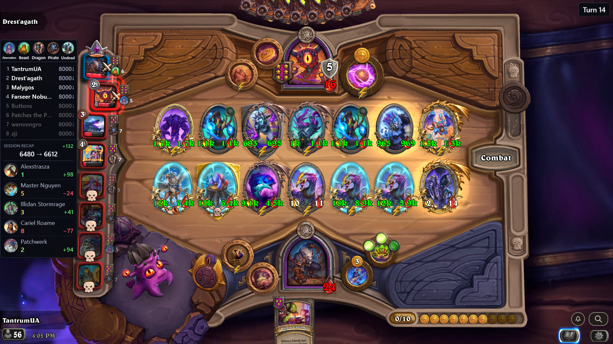

# Tantrum's Battlegrounds Toolkit

**English** | [Українська](README.ua.md)

A free overlay for Hearthstone Battlegrounds on Windows: opponents' MMR, tavern tiers and minion types by every
portrait, their last boards, your session's rating, Dark Gifts and an `F3` card search. It runs on its own, with no
Hearthstone Deck Tracker or other tracker needed, and also beside HDT or Firestone.

**Features, pictures and the download: [hsbg.cards/plugin](https://hsbg.cards/plugin)**

## Install

Windows only. Run Hearthstone in **Borderless** or **Windowed** mode.

1. Download `TantrumsBattlegroundsToolkit-Setup-X.Y.Z.exe` from
   [Releases](https://github.com/RTantrumR/Tantrums-Battlegrounds-Toolkit/releases/latest) or from
   [hsbg.cards/plugin](https://hsbg.cards/plugin).
2. Run it. If Windows SmartScreen warns about an unknown publisher, click *More info → Run anyway*.
3. Start Hearthstone. The toolkit lives in the Windows tray: click its icon for the settings, press `F3` in the game
   for the card search.

Coming from the HDT plugin? Run the same Setup: it switches the old plugin off, so nothing shows twice.

Updates: a bell next to the in-game search button says when a new version is out. The toolkit never downloads or
installs a program by itself; updating is the same Setup. [Release notes](https://github.com/RTantrumR/Tantrums-Battlegrounds-Toolkit/releases)

## Privacy

The toolkit downloads card data, card art, the mods list and notices from hsbg.cards and checks GitHub for a new
release. If you leave **Match data** on (the Setup asks; **Settings → Match data** has the same switch), each Solos
match sends a short report to hsbg.cards for community statistics: the lobby's heroes, minion types and places, your
rating and your final board, with no names, neither yours nor your opponents'. Full text: hsbg.cards'
[privacy policy](https://hsbg.cards/privacy#match-stats).

## Uninstall

Remove "Tantrum's Battlegrounds Toolkit" under Windows **Settings → Apps**. Settings and the card-art cache live in
`%APPDATA%\TantrumsBattlegroundsToolkit\`; delete that folder too to remove everything.

## Building from source

See [BUILDING.md](BUILDING.md). Corrections to the toolkit's own texts are welcome as edits to
`HsbgCardLookup/data/ui/<language>.json`.

## License

[Apache License 2.0](LICENSE). See [NOTICE](NOTICE) for third-party components.

MMR showcase is inspired by [HDT-BGMMRPlugin](https://github.com/Reign-in-blood/HDT-BGMMRPlugin) and was made in
cooperation with the author.

Hearthstone is a trademark of Blizzard Entertainment, Inc. This is an unofficial, fan-made tool, not affiliated with
or endorsed by Blizzard.
