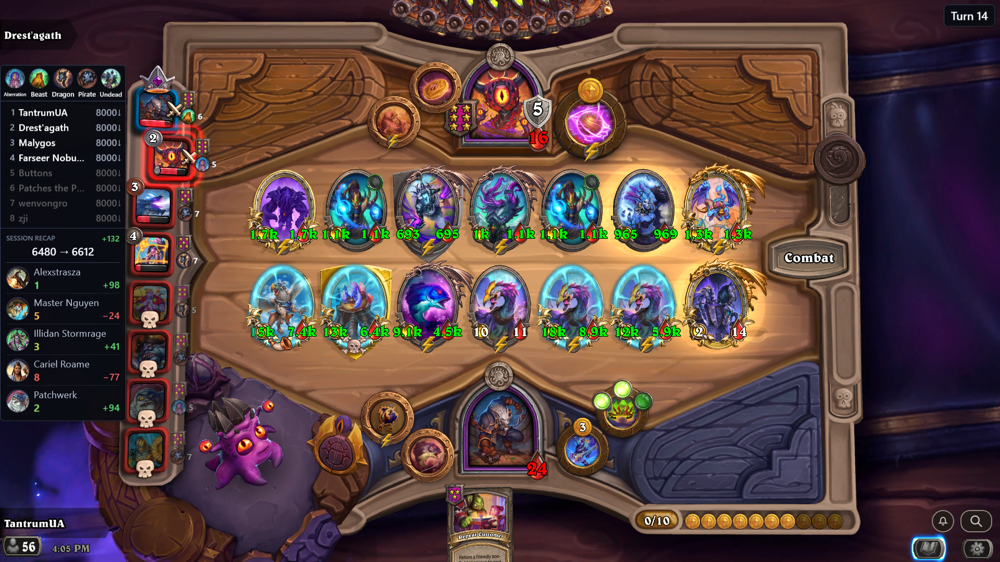

# Tantrum's Battlegrounds Toolkit

[English](README.md) | **Українська**

Безкоштовний оверлей для Полів бою Hearthstone на Windows: MMR суперників, рівні таверни й типи істот біля кожного
портрета, їхні останні столи, рейтинг вашої сесії, темні дари й пошук карт на `F3`. Працює сам по собі, без
Hearthstone Deck Tracker чи іншого трекера, а також поруч із HDT або Firestone.

**Функції, зображення та завантаження: [hsbg.cards/plugin](https://hsbg.cards/plugin)**

## Встановлення

Лише Windows. Запускайте Hearthstone у режимі **Borderless** або **Windowed**.

1. Завантажте `TantrumsBattlegroundsToolkit-Setup-X.Y.Z.exe` з
   [Releases](https://github.com/RTantrumR/Tantrums-Battlegrounds-Toolkit/releases/latest) або з
   [hsbg.cards/plugin](https://hsbg.cards/plugin).
2. Запустіть його. Якщо Windows SmartScreen попереджає про невідомого видавця, натисніть *Докладніше → Усе одно
   запустити*.
3. Запустіть Hearthstone. Тулкіт живе в треї Windows: клацніть його значок, щоб відкрити налаштування, а в грі
   натисніть `F3` для пошуку карт.

Переходите з плагіна для HDT? Запустіть той самий Setup: він вимкне старий плагін, щоб нічого не показувалося двічі.

Оновлення: дзвіночок біля кнопки пошуку в грі повідомляє про нову версію. Тулкіт ніколи сам не завантажує й не
встановлює програм; оновлення — це той самий Setup. [Нотатки релізів](https://github.com/RTantrumR/Tantrums-Battlegrounds-Toolkit/releases)

## Конфіденційність

Тулкіт завантажує дані карт, арт, список модів і сповіщення з hsbg.cards і перевіряє на GitHub, чи вийшла нова
версія. Якщо **Дані матчів** увімкнено (Setup питає про це; у **Налаштування → Дані матчів** той самий перемикач),
після кожного матчу соло на hsbg.cards іде короткий звіт для статистики спільноти: герої лобі, типи істот і місця,
ваш рейтинг і ваш фінальний стіл, без імен — ні вашого, ні суперників. Повний текст:
[політика конфіденційності](https://hsbg.cards/privacy#match-stats) hsbg.cards.

## Видалення

Видаліть «Tantrum's Battlegrounds Toolkit» у Windows **Settings → Apps**. Налаштування й кеш арту лежать у
`%APPDATA%\TantrumsBattlegroundsToolkit\`; видаліть і цю теку, щоб прибрати все.

## Збірка з вихідного коду

Див. [BUILDING.md](BUILDING.md) (англійською). Виправлення текстів тулкіта приймаються як правки до
`HsbgCardLookup/data/ui/<мова>.json`.

## Ліцензія

[Apache License 2.0](LICENSE). Сторонні компоненти — див. [NOTICE](NOTICE).

Показ MMR натхненний плагіном [HDT-BGMMRPlugin](https://github.com/Reign-in-blood/HDT-BGMMRPlugin) і зроблений у
співпраці з його автором.

*Hearthstone — торговельна марка Blizzard Entertainment, Inc. Це неофіційний фанатський проєкт, не пов'язаний із
Blizzard і не схвалений нею.*
