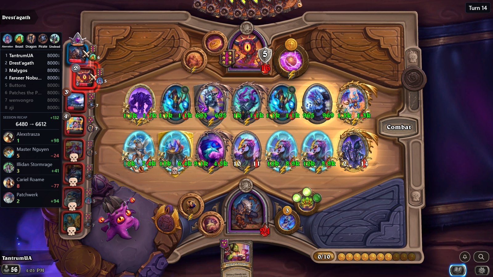
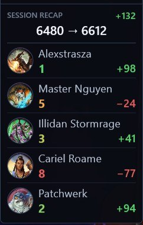
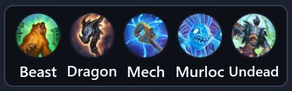
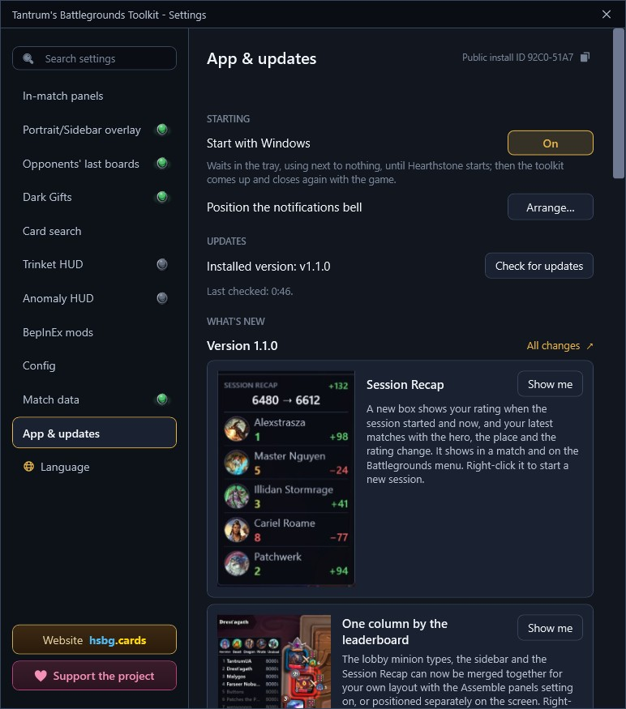
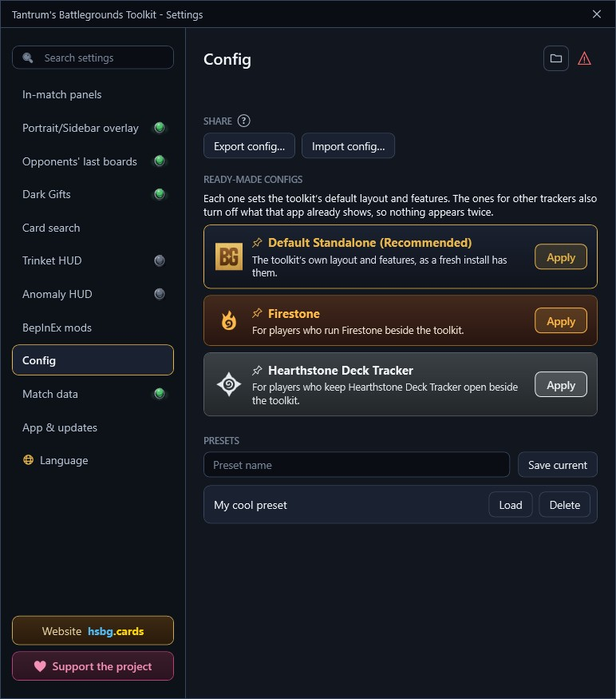
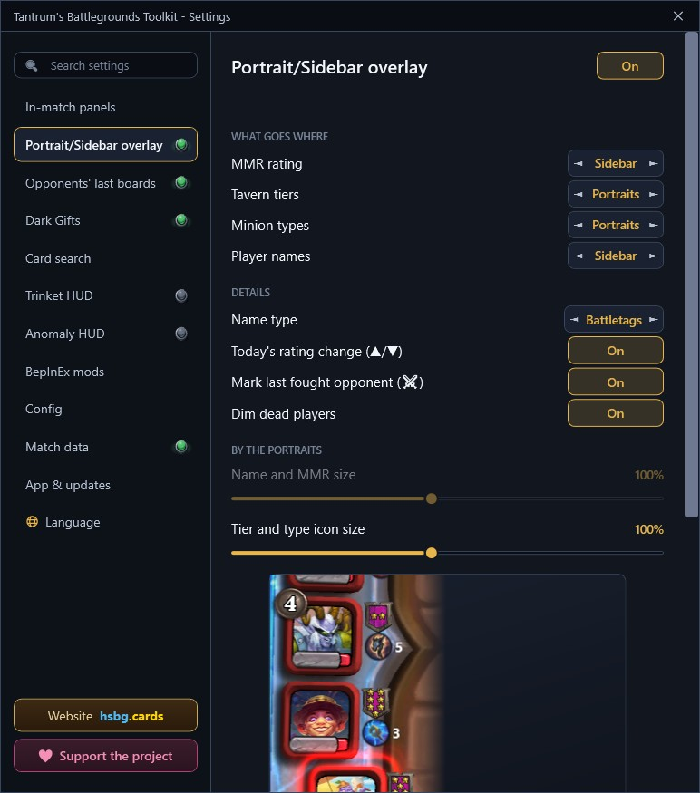

v1.1.0: Session Recap, opponents' boards, panels you can assemble, and patch notes inside the app

### New in the match
- **Session Recap**: your rating when the session started and now, and your latest matches with the hero, the place and the rating change. It shows in a match and on the Battlegrounds menu, for Solos or Duos, whichever you play. A session ends after 4 hours without a ranked match; right-click the box to start a new one.

- **Lobby minion types**: the five types in this lobby stay on screen all match. Lay them out as one row, one column, two rows or three rows, as icons, names or both, and add the season's banned types crossed out if you like. Right-click the box to change it on the spot.

- **Opponents' last boards**: hover a leaderboard portrait to see the board that player last fought you with, and on which turn. Rest the cursor on a minion for its card. With "Click a portrait to keep its board open" on, the board stays, and the arrow in its corner resizes it.

- **Turn counter**: the turn number, top right.
- **Assemble panels**: drag the lobby types box, the sidebar, the Session Recap and the turn counter against each other and they join into one panel that moves as one. Right-click it to take it apart. Joined boxes can stretch to one width, scale up together, or keep their own sizes.
- **New default layout**: the lobby types, the sidebar and the Session Recap stand as one column left of the leaderboard, from under your opponent's name to above yours, with tavern tiers and minion types by the portraits.
- **Two-line rows**: the sidebar and the Session Recap put the numbers under the name, for narrower boxes with larger text.
- **The bell**, next to the search button, replaces the "Update available" tag. A green number means a new version, a yellow one new patch notes. Click it to download the update, skip it, or read the patch notes in your language.

- The search button and the bell can be moved and resized like the other boxes.
- The overlay leaves Hearthstone's friends list and Esc menu clear while they are open.

### Settings
- A new window: pages down the left with a search box above them, and on most pages a picture of the real game showing what the setting does.
- **Patch notes inside the app**: App & updates shows what each version brought, a card per change with a picture and a "Show me" button that takes you to the setting. The tab says "New" after an update until you open it.

- **Config page**: export your settings to a file, import someone else's, or keep named presets. Ready-made configs set everything at once: "Default Standalone (Recommended)" is the toolkit's own layout, and the Firestone and Hearthstone Deck Tracker ones turn off what that app already shows, so nothing appears twice.

- **In-match panels** holds the turn counter, the Session Recap, the lobby types and assembling, each with its picture. "Card search" has the hotkeys, the in-game button, floating cards and the card art folder.

- **Portrait/Sidebar overlay**: two sliders size what is drawn by the portraits, the name and MMR plate and the tier and type icons, from 70% to 135%, with a picture of the leaderboard that follows.

- **BepInEx mods**: the mods listed on hsbg.cards, which ones you have and at which version, and their Setup a click away. Installed mods can be shown in Explorer, checked for an update or moved to the Recycle Bin. New in the list: Tantrum's Board Fix, which keeps your board from jumping around while you buy and reorder.

- **App & updates**: Start with Windows, the bell's position, "Check for updates" and the time of the last check.
- Ukrainian: menus, panels and the Setup. Cards and the card search stay in English.
- Arrange with Hearthstone closed starts the game first.
- A "Website" button opens hsbg.cards in your language.

### Standalone program
- After a fresh install, and on the first start after updating, the settings open once on the Config page.
- Click the tray icon to open the settings; a double click still opens the card search. The tray menu is in the toolkit's dark colours.
- The Language page has no "Automatic" row any more: it followed Hearthstone Deck Tracker's language. A language you never picked stays English.

### Match data
- After each Solos match the toolkit sends a short report to hsbg.cards for community statistics: the lobby's heroes, minion types and places, your rating and your final board. No names, neither yours nor your opponents'.
- The Setup asks about it, ticked by default; Settings → Match data has the same switch. Off means nothing is sent.
- "Community stats" on that page opens what everyone's matches add up to.
- The toolkit keeps your last 200 matches in its data folder.

### Setup
- The Setup and the toolkit's files carry a signature naming TantrumUA and hsbg.cards. Windows still says "Unknown publisher": it is our own certificate, which no authority vouches for.
- It installs the standalone program only: Hearthstone Deck Tracker stops running plugins on November 30. If the old plugin is still switched on, the Setup closes HDT and switches it off, so the toolkit doesn't run twice.
- The Setup is about 12 MB: its files are no longer packed, which some antivirus scanners read as suspicious.
