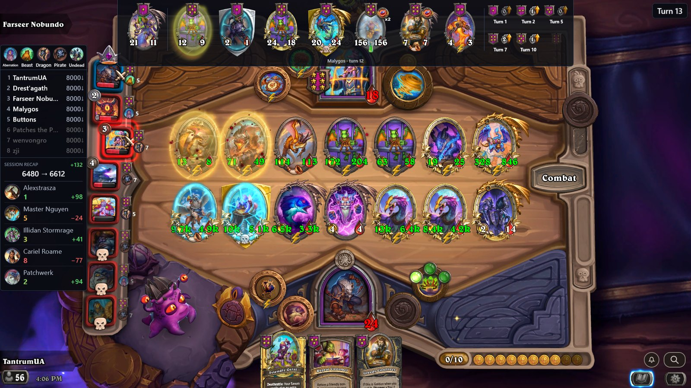
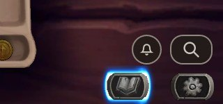
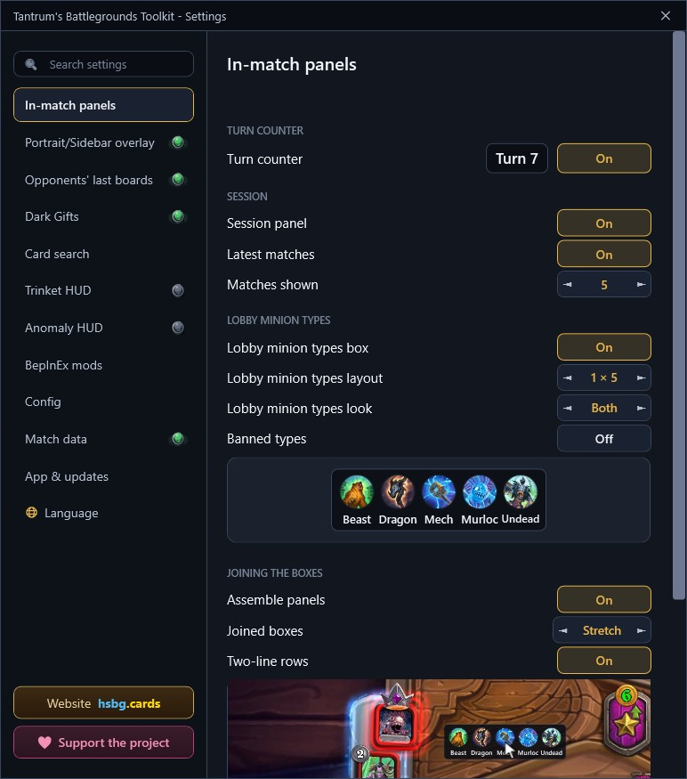
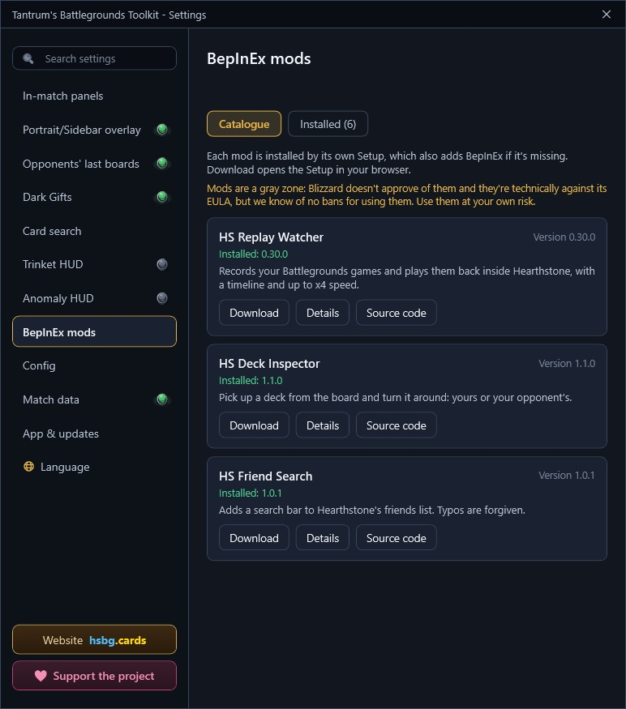

v1.1.0: Session Recap, opponents' boards, panels you can assemble, and patch notes inside the app

### New in the match
- **Session Recap**: a new box shows your rating when the session started and now, and your latest matches with the hero, the place and the rating change. It shows in a match and on the Battlegrounds menu, for Solos or Duos, whichever you play. A session ends after 4 hours without a ranked match; right-click the box to start a new session.

- **Lobby minion types**: the five types in this lobby stay on screen all match. Lay the box out as 1x5, 5x1, 2x3 or 3x2, whatever suits your vision. Show icons, names or both, and turn the banned types on or off to show them crossed out underneath.

- **Opponents' last boards**: hover a leaderboard portrait to see the board that player last fought you with, and on which turn. Rest the cursor on a minion for its card. With "Click a portrait to keep its board open" on, the board stays, and the arrow in its corner resizes it.

- **Turn counter**: the turn number, top right.
- **Assemble panels**: the lobby minion types, the sidebar, the Session Recap and the turn counter can be merged together for your own layout with the Assemble panels setting on, or positioned separately on the screen. Right-clicking some panels gives you options to interact with them and to take them apart. Joined boxes can stretch to one width, scale up together, or keep their own sizes.
- **New default layout**: the lobby types, the sidebar and the Session Recap stand as one column left of the leaderboard, from under your opponent's name to above yours, with tavern tiers and minion types by the portraits.
- **Two-line rows**: if the rows of the sidebar and the Session Recap are too wide, turn this on to make them taller instead (it might look funky in some places).
- **The bell**: a bell next to the in-game search button turns green when a new version is out and yellow for new patch notes, and replaces the "Update available" tag. Click it to download the update, skip it, or read the patch notes in your language.

- The bell and the search button can now be moved and resized like the other boxes (it was highly requested).
- The overlay leaves Hearthstone's friends list and Esc menu clear while they are open.

### Settings
- A new window: pages down the left with a search box above them, and on most pages a picture of the real game showing what the setting does.
- **Patch notes inside the app**: App & updates shows what each version brought, a card per change with a picture and a "Show me" button that takes you to the setting. The tab says "New" after an update until you open it.

- **Config page**: export your settings to a file, import someone else's, or keep named presets. It also has ready-made setups: the toolkit's own default (recommended), and versions for players who run Firestone or Hearthstone Deck Tracker beside it, which turn off what that app already shows. Those were measured at release; other trackers might add features that would need these configs changed.

- **In-match panels** holds the turn counter, the Session Recap, the lobby types and assembling, each with its picture. "Card search" has the hotkeys, the in-game button, floating cards and the card art folder.

- **Portrait/Sidebar overlay**: two sliders set the size of the name and MMR plate and of the tier and minion type icons by the leaderboard portraits, from 70% to 135%, with a picture that follows as you drag to help you see the result.

- **BepInEx mods**: see the mods from hsbg.cards, which of them you have and at which version, and open their Setup in one click. Installed mods can be shown in Explorer, checked for an update or moved to the Recycle Bin. New in the list: Tantrum's Board Fix, which keeps your board from jumping around. Many players may already know it; it can now be installed and uninstalled quickly from the toolkit.

- **App & updates**: Start with Windows, the bell's position, "Check for updates" and the time of the last check.
- Ukrainian: the toolkit's menus, panels and Setup are now also in Ukrainian. Cards and the card search stay in English in that language.
- Arrange with Hearthstone closed starts the game first.
- A "Website" button opens hsbg.cards in your language.

### Standalone program
- After a fresh install, and on the first start after updating, the settings open once on the Config page.
- Click the tray icon to open the settings; a double click still opens the card search. The tray menu is in the toolkit's dark colours.
- The Language page has no "Automatic" row any more: it followed Hearthstone Deck Tracker's language. A language you never picked stays English.

### Match data
- After each Solos match the toolkit sends a short report to hsbg.cards, with no names attached: the lobby's heroes, minion types and places, your rating and your final board. Everyone's matches add up to community statistics of heroes, minion types and places, shown completely free of charge.
- The Setup asks about it, ticked by default. You can turn it off in Settings → Match data, and then nothing is sent.
- "Community stats" on that page opens what everyone's matches add up to.
- The toolkit keeps your last 200 matches in its data folder.

### Setup
- The Setup and the toolkit's files carry a signature naming TantrumUA and hsbg.cards. Windows still says "Unknown publisher": it is our own certificate, which no authority vouches for.
- It installs the standalone program only: Hearthstone Deck Tracker stops running plugins on November 30. If the old plugin is still switched on, the Setup closes HDT and switches it off, so the toolkit doesn't run twice.
- The Setup is about 12 MB: its files are no longer packed, which some antivirus scanners read as suspicious.
